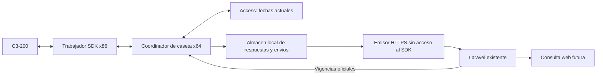

# Control de acceso: coordinador e ingesta en Laravel

Diseno al 2026-10-23. Usuario confirma la primera entrega de backend local:
ingesta autenticada, almacenamiento y pruebas. Esa etapa ya esta implementada
localmente; no se ha desplegado ni conectado con caseta. Emisor/outbox local tambien
preparado y probado (23 pruebas); coordinador, pantalla y operaciones pendientes.
Ver [emisor local](control-acceso-emisor-local.md). Contrato exacto y evidencia de pruebas en
[control-acceso-api-v1.md](control-acceso-api-v1.md); evidencia de hardware en
[control-acceso-zkteco.md](control-acceso-zkteco.md).

## Base verificada y alcance inicial

- Laravel existente: composer.json requiere Laravel ^12.0 y Sanctum ^4.2;
  autenticacion humana en User con role, auth:sanctum en rutas protegidas.
- GET /api/vencimientos calcula fechas en ZkApiController; no tiene middleware
  de token aplicado en routes/api.php. No copiar esa exposicion a rutas nuevas.
- Polling r2: sincronizar_vigencias.cycle(password, apply, only) consulta API,
  Access y C3 reales; worker() abre procesos x86 para leer/aplicar fechas.
  main() mantiene sync.lock durante todo el proceso y espera 60 s despues del ciclo.
- Gestor: mantenimiento.ps1 pausa/reanuda SanIsidro-Vigencias y usa protocolo 2.
  Vigilancia revisa heartbeat y ultimo ciclo correcto, con umbral de 5 minutos.
- Historial transaction releido con opciones vacias permanece identico en las
  muestras, incluso al reconectar. RT devuelve eventos que coinciden con historial.
  Hubo -2 al consultar A despues de abrir B simultaneamente; no certificar
  compatibilidad de clientes concurrentes ni causa universal con una sola muestra.
- RT entrega acumulados; se alcanzo estado 255. Su hora no se actualizo entre dos
  muestras: no usarla como certificacion del RTC. Puertas fisicas sin mapear.

Primera entrega confirmada: almacenamiento y recepcion autenticada de estado y
eventos observados. Pantalla, captura asistida y solicitudes de alta/recuperacion
se construyen despues. API unica autoridad de vigencias en todas las etapas.

## Responsabilidades

El coordinador controla el unico acceso propio al SDK. El emisor puede enviar
datos mientras el coordinador trabaja, sin cargar la DLL ni tocar Access.
El navegador consulta Laravel; no se comunica con la IP privada de la C3.

## Coordinador y compatibilidad operativa

Primera estrategia propuesta: reutilizar la logica de cycle() en una version
preparada aparte, conservando validacion API, comparacion real por ciclo,
respaldos, escritura parcial, verificacion y tratamiento de ausentes/no encontrados.
No copiar el calculo de vigencias a Python ni cambiar tolerancias del backend.

Secuencia de ejecucion:
1. Tomar el mismo sync.lock durante la vida del coordinador; una sola instancia.
2. Cuando toca vigencias, cerrar y confirmar salida del trabajador RT antes de
   llamar cycle(). Sus trabajadores x86 operan sin otra sesion propia activa.
3. Al terminar el ciclo, incluso si fallo, cerrar los recursos de ese ciclo antes
   de decidir si se puede reconectar RT. Prioridad a vigencias; no solapar SDK.
4. Entre ciclos, leer RT por tandas acotadas, guardar inmediatamente y revisar
   la solicitud de parada. No prolongar indefinidamente la lectura de acumulados.
5. Ante mantenimiento, terminar la operacion en curso, guardar lo ya recibido,
   cerrar el SDK y liberar el bloqueo. Reanudacion desde el gestor.

Mantener estado.json protocol 2 con PID real, phase, heartbeat_utc, last_ok_utc,
consecutive_errors y ciclo correcto referido exclusivamente a **vigencias**.
Agregar estado propio del lector y emisor en otro documento/estructura; un RT
correcto no debe ocultar un fallo de vigencias ante SanIsidro-Vigilancia.
No iniciar ni reinstalar tareas desde la nueva interfaz por aceptar solicitudes.

Valores iniciales propuestos, configurables y pendientes de validar con carga real:

| Tarea | Valor inicial |
| --- | --- |
| Vigencias | Conservar espera de 60 s despues del ciclo |
| RT durante espera | Una consulta por segundo; tandas de acumulados acotadas |
| Envio de estado | Cada 30 s y ante cambio de salud |
| Envio de lotes | Cada 5 s si hay pendientes; hasta 100 respuestas o 1 MiB por lote |
| Falta de reporte web | Advertir tras 90 s sin reporte, sin atribuir causa al hardware |
| Salud de vigencias | Conservar umbral operativo de 5 min |

ZKAccess no respeta sync.lock: su uso requiere mantenimiento coordinado. Los
diagnosticos anteriores no probaron concurrencia con ese programa.
La transicion futura debe preservar usuario Dell, credenciales DPAPI, arranque
al iniciar sesion, modo oculto, parada cooperativa y respaldo del paquete r2.
No hay autologon confirmado; no prometer funcionamiento antes de iniciar sesion.

## Persistencia local y limites de entrega

Implementado localmente: almacen SQLite de respuestas originales y envios;
la interpretacion de filas se conserva en Laravel. SQLite de Python en Dell sigue
pendiente de comprobar antes de instalar.
Guardar buffer/respuesta, SHA256, codigo SDK, identidad de equipo, instante de
consulta, orden de fila y UUID local persistente antes de permitir el envio.
Procesar toda la respuesta; no limitar la captura a la primera tarjeta mostrada
por los diagnosticos. Estado 255 no es un evento vehicular.

Si no hay Internet, acumular lo capturado y reintentar con espera progresiva.
Una falla del emisor no detiene vigencias. Falta de disco o error al persistir
detiene lecturas RT y genera salud degradada; no seguir consumiendo sin guardar.
Formato desconocido se conserva para revision sin inventar su interpretacion.

Existe una ventana entre GetRTLog y la escritura local: un corte de luz ahi puede
perder una respuesta temporal. No existe ACK propio previo a esa lectura en lo
probado. Los eventos 0/20 muestreados existen en transaction, pero no se ha validado
recuperacion completa por rango/indice ni todos los tipos. Antes de prometer
historial completo hay que probar reconciliacion, conservando multiplicidad.
No afirmar garantia de cero perdidas ni inventar un ID de evento de la C3.

El ID local protege reintentos HTTP. La deduplicacion de observaciones distintas
del mismo evento fisico es otro problema: no imponer unicidad global por hash,
tag/fecha ni por tupla, porque puede haber repeticiones legitimas en el mismo segundo.
Una respuesta historica se conserva con su origen y no se mezcla automaticamente
con RT hasta validar la reconciliacion. Retencion y capacidad pendientes de
dimensionar; no instalar borrado automatico sin definir esa politica.

## Contrato, version 1

En cada mensaje: protocol_version, agent_id, session_id y secuencia local.
Laravel resuelve agente/controlador autorizados desde la credencial; un serial
enviado en JSON no permite asumir otra identidad.

Estado:
- Version del agente y worker, PID/sesion y fecha de reporte del PC.
- Snapshot de vigencias con campos actuales protocol 2, no valores recalculados.
- Ultima comunicacion SDK, ultimo error y modo mantenimiento/desconocido.
- Lector: catching_up, status_observed, unknown o paused, con instante de
  comprobacion. status_observed significa que se vio 255, no reloj certificado.
- Emisor: pendientes locales, antiguedad del pendiente mas antiguo y ultimo ACK.
- Estado de vigilancia solo si realmente se leyo su archivo, con su fecha.

Lote de respuestas:

| Campo | Regla |
| --- | --- |
| batch_id | UUID persistido; mismo ID y contenido en reintentos |
| response_id | UUID persistente por llamada SDK |
| source | rt o transaction; nunca convertir estado 255 en tarjeta |
| sdk_return_code | Conservar; negativos son diagnostico, no eventos validos |
| raw_payload_base64 / sha256 | Bytes originales y hash; validar correspondencia |
| captured_started_utc / captured_ended_utc | Recepcion en caseta, distinta de hora del controlador |
| pc_local_time / windows_timezone | Contexto del PC, no zona certificada de C3 |
| ordinal (calculado en Laravel) | Posicion original; conservar incluso filas identicas |
| raw_fields / columnas (calculados en Laravel) | Numero de tarjeta, Pin, verificacion, puerta, codigo, sentido y tiempo originales; el agente no envia filas interpretadas |
| server_received_at_utc | Lo asigna Laravel; no lo decide el agente |

Codigo/tag/Pin como cadenas para conservar identificadores. device_time_raw se
guarda sin convertir silenciosamente a UTC. Para transaction conservar Time_second
ademas de cualquier conversion, con version del parser. Puertas como IDs sin
etiquetar entrada/salida hasta confirmar mapa. Asociacion actual con vecino se
resuelve desde web; no prueba quien tenia el tag cuando ocurrio un evento antiguo.

## Laravel: primera entrega local

Rutas iniciales implementadas localmente, sin despliegue:
- POST /api/control-acceso/agente/estado
- POST /api/control-acceso/agente/lotes

Credencial propia por agente, revocable, con secreto aleatorio guardado mediante
hash en backend y DPAPI en caseta. Middleware dedicado, fuera del grupo humano
auth:sanctum/corte.bloqueo. No usar una cuenta admin ni ampliar permisos de users
para representar una computadora. Permisos solo de ingesta de su dispositivo;
validar version, tamanos, esquema y contenido sin registrar credenciales/payload
completo en laravel.log. HTTPS saliente; no abrir puertos entrantes en caseta.

Tablas nuevas: control_acceso_agentes, control_acceso_estados, control_acceso_lotes,
control_acceso_respuestas y control_acceso_filas. Se conserva cada reporte de estado,
sin que un mensaje atrasado sobrescriba otro; consulta de estado actual pendiente.
audit_logs no sustituye el almacen de eventos
del hardware. No enlazar obligatoriamente cada fila a tags/vecinos: debe aceptar
tarjetas desconocidas y conservar eventos aunque cambie la asociacion o se borre
un registro web. No crear asociaciones por recibir una lectura.

Laravel confirma batch_id, hash y aceptacion durable solo despues de la transaccion.
Mismo ID/mismo contenido devuelve el mismo ACK; mismo ID/contenido diferente se
rechaza con conflicto, sin sobrescribir. El agente marca enviado tras validar el
ACK. Una respuesta 2xx generica no permite borrar originales. Validar todo el lote
antes de aceptarlo; sin exito parcial silencioso ni asumir que hay un worker de
colas instalado en produccion. Primera version puede persistir sincronicamente.

Consulta web posterior con auth:sanctum y autorizacion backend: propuesta de lectura
para admin y vigilancia, credenciales/configuracion reservadas a admin. Esos valores
de role aparecen en el codigo; el alcance de operaciones humanas sigue por aprobar.
La ingesta del agente no concede lectura general ni permisos de alta/recuperacion.
La ruta actual /vencimientos y su autenticacion requieren una decision separada;
no cambiar el acceso del polling instalado durante esta primera entrega.

## Etapas y criterios de aceptacion

1. **Contrato e ingesta Laravel.** Confirmada e implementada localmente.
   Fixtures ficticios con formatos verificados: autenticacion/revocacion, lotes
   invalidos, reintentos, conflicto de ID, atomicidad, 255 y tipos desconocidos.
   Pruebas SQLite aprobadas; migracion y concurrencia verificadas en MySQL 8.4.13
   aislado (24 pruebas / 186 aserciones); instancia detenida al terminar. Ver
   [ensayo MySQL](control-acceso-ensayo-mysql.md).
   Sin pantalla, solicitudes operativas ni despliegue a produccion en esta etapa.
2. **Emisor y almacen local.** Implementado y probado localmente: 23 pruebas,
   incluidas tres contra Laravel real de ensayo, Internet interrumpido, salida
   abrupta, ACK perdido y falta de disco. Recibe snapshots explicitos; recoleccion
   automatica de archivos actuales sin SDK pendiente. Compatibilidad de SQLite
   en disco y DPAPI verificada en Dell/Python32 mediante 13 comprobaciones;
   entrega por red desde Dell al servidor de ensayo aun pendiente.
3. **Coordinador en carpeta separada.** Simular la secuencia sin escrituras; probar
   cierre SDK antes de cycle(), parada del gestor, watchdog y persistencia. Consulta
   real solo con mantenimiento; aplicacion de fechas con paquete nuevo requiere
   aceptacion y comparacion frente a r2. Resolver recuperacion/gaps antes de
   declarar historial completo. Ningun proceso permanente paralelo a r2.
4. **Transicion operativa autorizada.** Respaldo, prueba separada, rollback y
   confirmacion antes de reemplazar la tarea/codigo de caseta. No editar instalacion
   a mano. Backend por Git y despliegue probado fuera del docroot, con confirmacion.
5. **Pantalla y captura asistida.** Salud desglosada, acumulados con sus fechas,
   filtro/consulta por tag, captura armada y confirmada por operador. Aun pendiente
   validar correspondencia fisica y distinguir evento posterior a armar de backlog.
6. **Altas/recuperaciones.** Solicitud humana autorizada en backend, reconsulta de
   vigencia oficial al ejecutar, resultados verificados y conciliacion de fallos.
   Sin dinero ni cortes modificados para habilitar tags. Diseno detallado posterior.

Pendientes de acuerdo: frecuencias/limites definitivos, retencion, permisos humanos
y estrategia de reconciliacion historica. Reloj exacto y mapa fisico se muestran
como desconocidos hasta obtener evidencia; no bloquear la ingesta de originales
ni presentar esas propiedades como verificadas.
